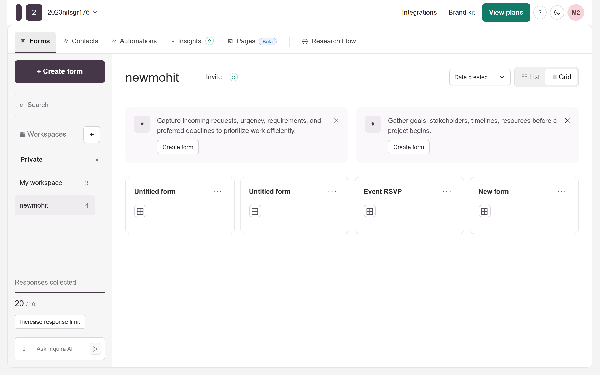
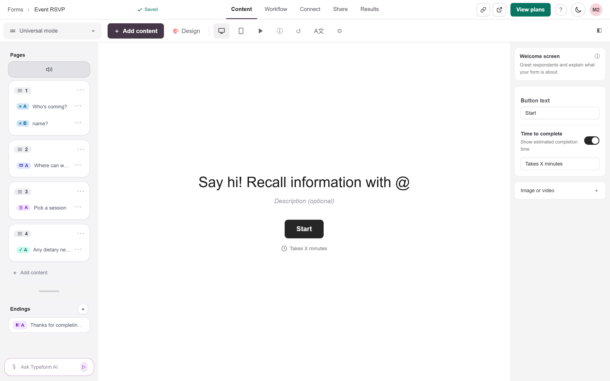
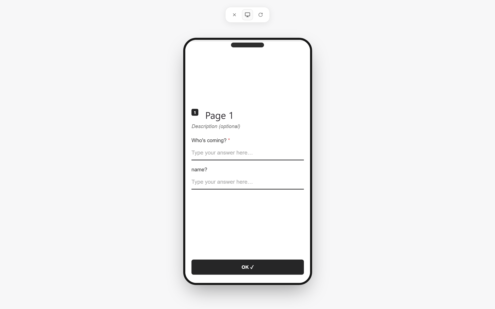
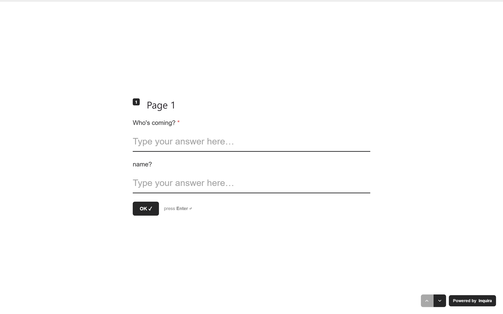
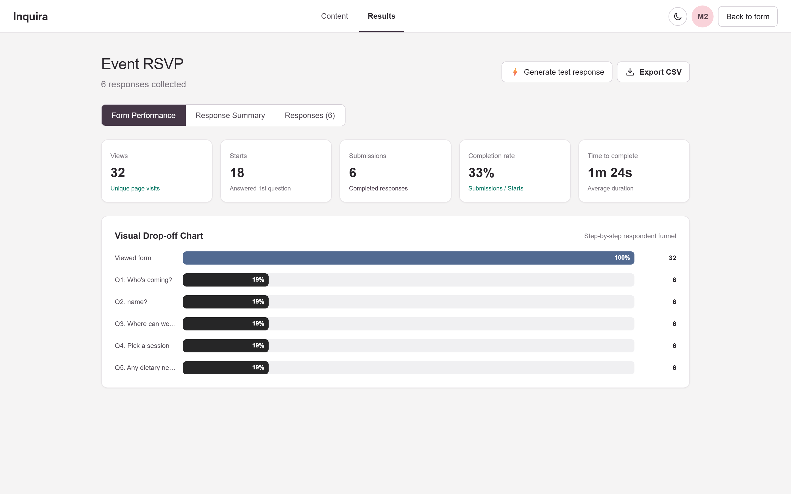
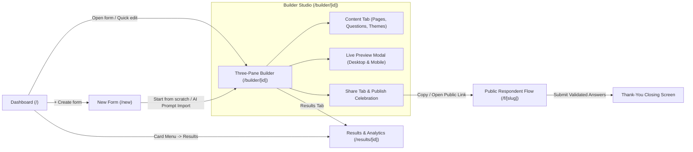
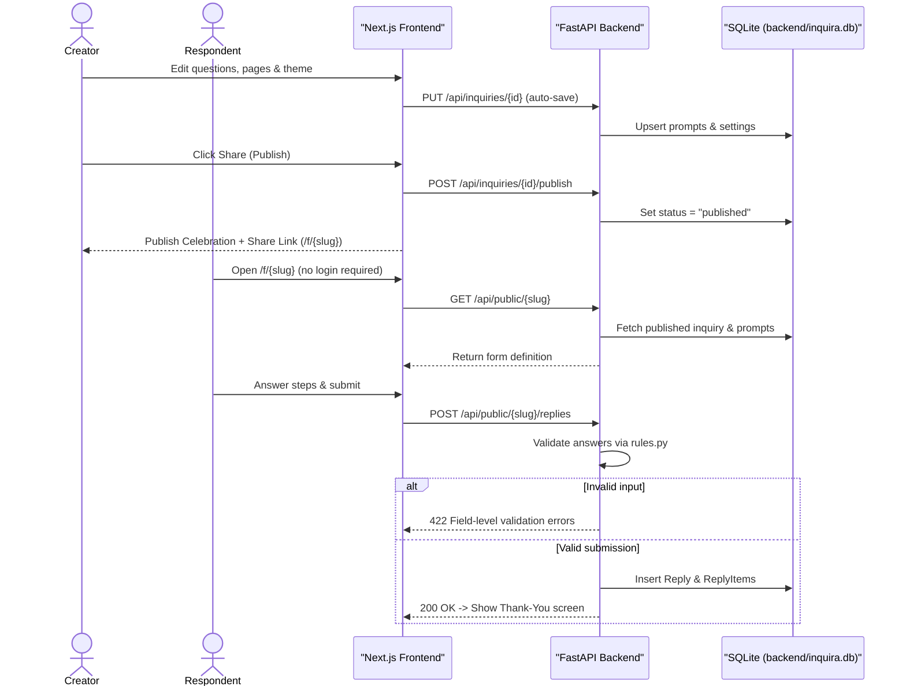
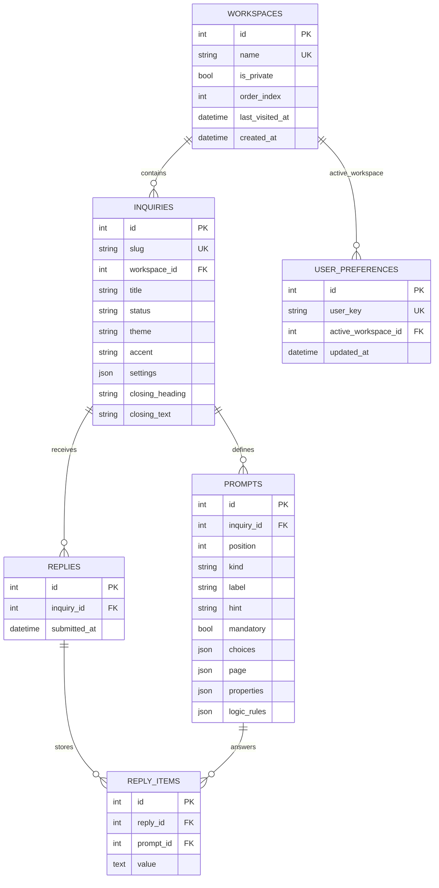

# Inquira – Typeform Fullstack Builder & Respondent Runner

A production-grade, conversational form-building platform inspired by **Typeform**, featuring a workspace dashboard, three-pane drag-and-drop multi-page builder, live desktop/mobile preview, animated one-question-at-a-time public respondent flow, and visual drop-off analytics.

---

## 📸 Main Features & Screenshots

### 1. Workspace & Form Management Dashboard (`/`)
Manage multiple private and team workspaces with persistent active-workspace selection, Grid/List views, search modal, sorting (`Date created`, `Last updated`, `Alphabetical`), form duplication, drag-and-drop movement across workspaces, response quota tracking, and light/dark themes.



---

### 2. Three-Pane Form Builder & Multi-Page Editor (`/builder/[id]`)
Build forms inside a live three-pane studio:
- **Left Sidebar**: Reorder **Pages** and drag-and-drop questions within or across pages, configure **Welcome** and **Ending** screens, and manage multi-field page groups.
- **Center WYSIWYG Canvas**: Inline-editable headings, descriptions, theme previews (`Pearl white`, `Classic blue`, `Inky black`, `Forest green`), and live dark mode support.
- **Right Inspector**: Configure **19 question types** (8 core + 11 extended), required toggles, choices, default country codes, logic rules modal, and form settings (`Inquira branding`, `Navigation arrows`, `Progress bar`).



---

### 3. Interactive Live Preview (Desktop & Mobile Frame)
Switch seamlessly between Desktop and Mobile device frames both on the canvas and inside the full-screen interactive Preview modal (`Close`, `Desktop/Mobile toggle`, `Restart`) to test keyboard navigation, required validation, and multi-field pages before publishing.



---

### 4. One-Question-at-a-Time Respondent Flow (`/f/[slug]`)
Share any published form via its public slug with **no authentication required**:
- Full-screen conversational slides with smooth cascade entrance animations and a top progress bar.
- Full keyboard navigation: `Enter` to advance, `Shift + Enter` for multiline, `↑`/`↓` arrows, `A`–`Z` for multiple choice, `Y`/`N` for yes/no, and `1`–`5` for star ratings.
- Dual client-side and server-side validation (`422` field-level error feedback) followed by a customizable thank-you screen.



---

### 5. Results, Visual Drop-off Funnel & CSV Export (`/results/[id]`)
Analyze performance in real time across three views:
- **Form Performance**: Views, Starts, Submissions, Completion Rate, Average Time, and a step-by-step **Visual Drop-off Chart**.
- **Response Summary**: Per-question breakdown bars and numeric averages.
- **Responses Table & CSV**: Inspect individual submissions in a modal, generate realistic test responses in one click, or export all submissions to CSV.



---

## 🗺 Site Flow & Feature Diagrams

### End-to-End Site Navigation Flow



### Complete Feature Map

```mermaid
flowchart TD
    INQ["Inquira Platform"] --> WS["Workspaces & Dashboard"]
    INQ --> BLD["Form Builder Studio"]
    INQ --> RUN["Public Respondent Runner"]
    INQ --> ANA["Results & Analytics"]

    WS --> WS1["Create, Rename, Reorder & Delete Workspaces"]
    WS --> WS2["Grid / List View, Search Modal & Sort"]
    WS --> WS3["Form CRUD, Duplicate & Drag-to-Workspace"]
    WS --> WS4["Light / Dark Theme & Persistent Active Workspace"]

    BLD --> BLD1["Welcome & Ending Screen Editors"]
    BLD --> BLD2["Multi-Page Grouping & Cross-Page Drag-and-Drop"]
    BLD --> BLD3["19 Question Types (Core + Extended)"]
    BLD --> BLD4["Live Theme Gallery & Desktop/Mobile Preview"]
    BLD --> BLD5["Auto-Save, Publish Celebration & Share Link"]

    RUN --> RUN1["Zero-Auth Public Access (/f/[slug])"]
    RUN --> RUN2["Keyboard Shortcuts (Enter, Arrows, A-Z, Y/N, 1-5)"]
    RUN --> RUN3["Client + Server Field Validation (422 Errors)"]
    RUN --> RUN4["Animated Progress Bar & Closing Screen"]

    ANA --> ANA1["KPI Cards & Visual Drop-off Funnel"]
    ANA --> ANA2["Per-Question Summary Bars & Averages"]
    ANA --> ANA3["Tabular Submissions & Response Modal"]
    ANA --> ANA4["One-Click CSV Export & Test Data Generator"]
```



### Publish & Submission Lifecycle



### Database Schema (ER Diagram)



---

## 🌟 Supported Question Types (19 Total)

| Category | Question Kinds |
|---|---|
| **Core (8)** | `short_text`, `long_text`, `choice`, `dropdown`, `email`, `number`, `yes_no`, `rating` |
| **Extended (11)** | `contact_info`, `phone`, `address`, `url`, `checkbox`, `legal`, `nps`, `opinion_scale`, `ranking`, `matrix`, `date` |

---

## 🛠 Tech Stack

- **Frontend**: Next.js `14.2.15` (App Router), React `18.3.1`, TypeScript, Tailwind CSS
- **Backend**: Python (`3.11+` recommended; `3.11.9` in `render.yaml`), FastAPI, SQLAlchemy 2, Pydantic 2, Uvicorn
- **Database**: SQLite with foreign-key enforcement (`PRAGMA foreign_keys = ON`)

---

## 🚀 Setup & Startup Commands (Reviewed & Verified)

### Prerequisites
- **Node.js** `18+` (includes `npm`)
- **Python** `3.11+`

### 1. Backend (FastAPI + SQLite)
Open a terminal in the repository root:

```bash
cd backend
python -m venv .venv
```

Activate the virtual environment:
- **Windows (PowerShell)**:
  ```powershell
  .\.venv\Scripts\Activate.ps1
  ```
- **Windows (Command Prompt)**:
  ```cmd
  .venv\Scripts\activate.bat
  ```
- **macOS / Linux**:
  ```bash
  source .venv/bin/activate
  ```

Install dependencies and start the API server:
```bash
pip install --upgrade pip
pip install --prefer-binary -r requirements.txt
uvicorn app.main:app --reload --port 8000
```
- API root: `http://localhost:8000`
- Interactive Swagger docs: `http://localhost:8000/docs`
- SQLite database defaults to `backend/inquira.db` (resolved automatically via `backend/app/database.py`, with automatic `/tmp` fallback on read-only containers). Override with `DATABASE_URL` if needed.

### 2. Frontend (Next.js)
Open a **second** terminal in the repository root:

```bash
cd frontend
npm install
npm run dev
```
- App URL: `http://localhost:3000`
- Backend URL defaults to `http://localhost:8000`. To point at another backend URL, set `NEXT_PUBLIC_API_URL` in `frontend/.env.local`:
  ```env
  NEXT_PUBLIC_API_URL=http://localhost:8000
  ```

#### Production Build (Frontend)
```bash
cd frontend
npm run build
npm run start
```

#### Production Deployment (Backend — `backend/render.yaml`)
```bash
pip install --upgrade pip && pip install --prefer-binary -r requirements.txt
uvicorn app.main:app --host 0.0.0.0 --port $PORT
```

---

## 🧪 Testing & Verification Commands

> **Note**: Backend unit tests import `app.*` relative to `backend/`, so run them from inside `backend/` with the virtual environment activated.

### Backend Unit & Integration Tests (17 Tests)
```bash
cd backend
python -m unittest discover -s tests -v
```

### Frontend Typecheck
```bash
cd frontend
npx tsc --noEmit
```

### End-to-End API Verification Script
From the repository root (with backend dependencies installed in `backend/.venv`):
```bash
python scratch/verify_e2e.py
```

---

## 🏛 Project Structure

```text
inquira/
├── backend/
│   ├── app/
│   │   ├── database.py      # SQLite engine, path resolution, PRAGMA foreign_keys=ON
│   │   ├── main.py          # FastAPI routes, lifespan schema migrations & CORS
│   │   ├── models.py        # Workspaces, UserPreferences, Inquiries, Prompts, Replies, ReplyItems
│   │   ├── rules.py         # Server-side validation for all 19 question kinds
│   │   ├── schemas.py       # Pydantic request/response models
│   │   └── seed.py          # Automatic initial seed data
│   ├── tests/
│   │   ├── test_forms_api.py
│   │   ├── test_pages.py
│   │   └── test_rules.py
│   ├── render.yaml          # Render deployment config
│   └── requirements.txt
├── frontend/
│   ├── app/
│   │   ├── page.tsx         # Workspace Dashboard
│   │   ├── new/page.tsx     # AI / Scratch form creation page
│   │   ├── builder/[id]/    # Three-pane Form Builder & Preview modal
│   │   ├── f/[slug]/        # Public Respondent Flow
│   │   ├── results/[id]/    # Performance Funnel, Summaries, Responses & CSV
│   │   ├── icon.svg         # Browser tab favicon
│   │   └── layout.tsx       # Root layout with ThemeProvider & ToastProvider
│   └── components/
│       ├── Runner.tsx
│       ├── PhoneField.tsx
│       ├── AddContentModal.tsx
│       ├── PublishCelebration.tsx
│       ├── AccountMenu.tsx
│       ├── Dropdown.tsx
│       ├── Modal.tsx
│       ├── Toasts.tsx
│       └── ThemeProvider.tsx
└── docs/
    └── screenshots/         # Live application feature screenshots
```
